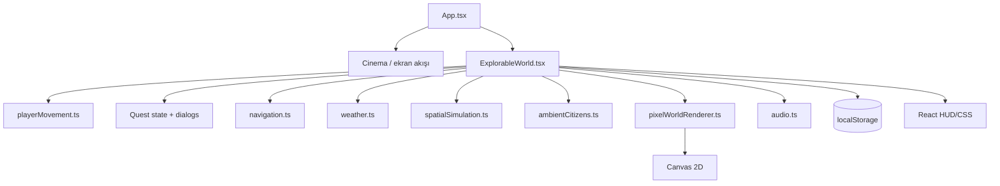

# Proje ve Mimari İncelemesi

## Özet mimari

## Modül tablosu

| Sistem | Dosya | Sorumluluk | Risk / gözlem |
|---|---|---|---|
| Başlatma ve ekran geçişi | `src/main.tsx`, `src/App.tsx` | React root, menu/story/world routing | Global `gameAudio` yaşam döngüsü component ekranlarına bağlı. |
| Dünya ve görev state’i | `src/ExplorableWorld.tsx` | Oyuncu, questStep 1–7, diyaloglar, save, HUD, loop | Çok fazla sorumluluk tek component’te; gameplay ve rendering coupling yüksek. |
| Oyuncu input/physics | `src/playerMovement.ts` | WASD/arrows/touch, substep collision, movement lock | Flood collision görev rotasını kilitleyebiliyor. |
| Navigasyon | `src/navigation.ts` | Compass bearing, route graph, obstacle/road traversability | Route önerisi ile gerçek player collision aynı model değil. |
| Hava durumu | `src/weather.ts` | Faz, rainfall, intensity, cloud/wind profile | Faz state’i ayrı; simulation tick ile UI zamanı arasında iki saat tabanı var. |
| Taşkın simülasyonu | `src/spatialSimulation.ts` | Deterministic cell/runoff/road depth | UI’da gösterilen bazı sabit metinler state ile birebir aynı değil. |
| Dünya çizimi | `src/pixelWorldRenderer.ts` | Canvas map, buildings, water, rain overlay | Canvas ve DOM HUD ayrı katmanlar; bazı durumlar yalnızca canvas’ta ölçülebilir. |
| Vatandaşlar | `src/ambientCitizens.ts` | Waypoints, state, speech bubbles, flood avoidance | Speech scheduling `Math.random()` kullanıyor; tam deterministik replay yok. |
| Audio | `src/audio.ts` | Web Audio music/SFX/weather cues | Browser unlock gerektiriyor; global singleton test izolasyonunu zorlaştırabilir. |
| UI/CSS | `src/cinema.css`, `src/styles.css` | HUD, dialogs, compass, responsive layout | 360×740 ve uzun Türkçe metinler için ayrıca kontrol gerekli. |
| Testler | `src/*.test.ts`, `e2e/*.spec.ts` | Unit, build, desktop/mobile browser tests | Chapter completion ve save/load E2E kapsamı eksik. |

## Ana veri bağımlılıkları

- `questStep` hedefleri `QUEST_STEPS` içinde sabit.
- `stormActive`, `weather`, `spatialState` dünya loop’una ref üzerinden taşınıyor.
- Oyuncu collision’ı `spatialState.hospitalRoadWaterDepth` ile doğrudan etkileniyor.
- Savunma state’i `activeDefenses` hem simulation hem renderer hem save payload tarafından kullanılıyor.
- Save `felaket_benim_quest_save_v2` anahtarını kullanıyor.

## Mimari öneri

Quest, weather/flood, input ve rendering state’lerini reducer veya küçük domain hook’larına ayırmak; özellikle `canPlayerOccupy` ile `isNavRouteTraversable` için ortak bir traversability service kullanmak gerekir. Bu, softlock riskini ve HUD/diyalog değer uyuşmazlığını azaltır.

